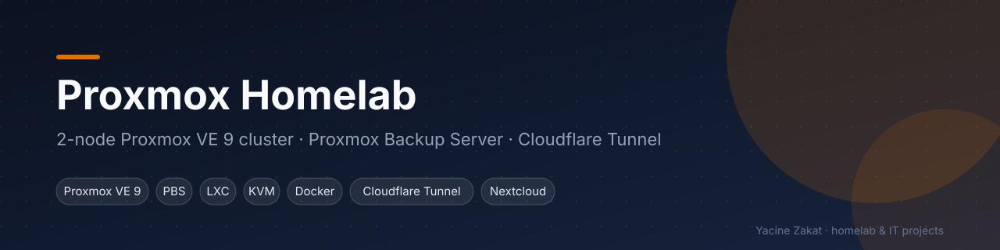
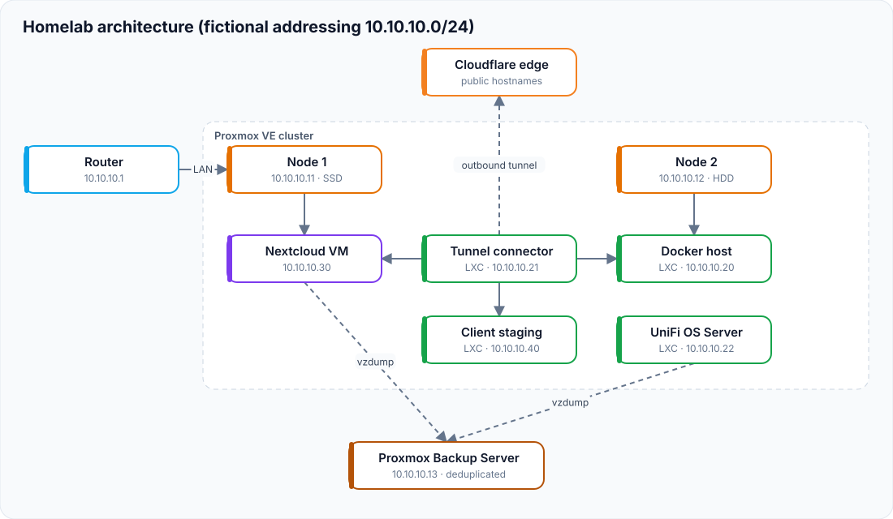

<p align="center"></p>

# Proxmox Homelab — 2-node Proxmox VE cluster + Proxmox Backup Server


## Overview

This repository documents the homelab I built and operate: a **two-node Proxmox VE 9 cluster** backed up to a separate **Proxmox Backup Server**. It runs a private cloud (Nextcloud), my public portfolio, a network controller, a Docker application host and a staging environment for a client web application — all published through a **Cloudflare Tunnel**, with no inbound port opened on the router.

What it demonstrates:

- Building and operating a Proxmox VE cluster (Corosync, quorum, LVM-thin storage)
- **In-place major upgrade Proxmox VE 8 → 9** (Debian 12 → 13) on a running cluster
- Proxmox Backup Server integration with scheduled, deduplicated backups
- KVM virtual machines and unprivileged LXC containers
- Docker / Docker Compose application hosting, multi-stage builds, Nginx
- Zero-port-forwarding publication with Cloudflare Tunnel
- Nextcloud administration and troubleshooting (PHP upgrade, database tuning, reverse-proxy trust)
- Network redesign (Raspberry Pi NAT gateway → dedicated router) without changing the addressing plan

> **Privacy:** this is a public repository. Real addresses, hostnames, domains, guest IDs, hardware identifiers, exact versions, ports, credentials and account names are intentionally omitted or replaced with generic labels. See [SECURITY.md](SECURITY.md).

---

## Architecture

<p align="center"></p>

| Role | Example address |
|---|---|
| Router / gateway | `10.10.10.1` |
| Node 1 / Node 2 | `10.10.10.11` / `10.10.10.12` |
| Proxmox Backup Server | `10.10.10.13` |
| Docker host · tunnel connector · network controller | `10.10.10.20` · `.21` · `.22` |
| Nextcloud VM · client staging | `10.10.10.30` · `.40` |

Addresses are a **fictional but consistent plan** used across all my repositories — not my real network.

Detailed documentation:

| Topic | File |
|---|---|
| Design and data flows | [docs/architecture.md](docs/architecture.md) |
| Nodes and workloads | [docs/infrastructure.md](docs/infrastructure.md) |
| Network design | [docs/networking.md](docs/networking.md) |
| What runs where | [docs/services.md](docs/services.md) |
| Backups and snapshots | [docs/backup-strategy.md](docs/backup-strategy.md) |
| Health checks | [docs/monitoring.md](docs/monitoring.md) |
| Security model | [docs/security.md](docs/security.md) |
| Incidents and fixes | [docs/challenges.md](docs/challenges.md) |
| Roadmap | [docs/future-improvements.md](docs/future-improvements.md) |

---

## At a glance

| | Node 1 | Node 2 | Backup server |
|---|---|---|---|
| Hardware | Small-form-factor desktop | Small-form-factor desktop | Separate machine |
| RAM | 16 GB | 16 GB | — |
| Disk | 1 TB SSD | 1 TB HDD | Dedicated datastore |
| Software | Proxmox VE 9 | Proxmox VE 9 | Proxmox Backup Server |
| Role | Storage-heavy VM | Lightweight LXC services | Backup target |

| Workload | Type | Node | Role |
|---|---|---|---|
| Nextcloud | KVM VM | Node 1 | Private cloud |
| Docker host | Unprivileged LXC | Node 2 | Portfolio, invoicing app, Portainer |
| Tunnel connector | Unprivileged LXC | Node 2 | Cloudflare Tunnel |
| Network controller | LXC | Node 2 | UniFi OS Server |
| Client staging | Unprivileged LXC | Node 2 | Next.js + PostgreSQL + Caddy |

---

## Highlights

- **Proxmox VE 8 → 9 upgrade** on both nodes after a full `pve8to9` pre-check, one node at a time, keeping quorum.
- **Proxmox Backup Server** on a dedicated machine outside the cluster: scheduled snapshot-mode backups of every guest, deduplicated, with e-mail notifications, plus manual backups before risky changes.
- **No inbound port forwarding**: a single lightweight connector container publishes all public sites.
- **Nextcloud on a full VM** and hardened: PHP upgrade, database update and missing indices, Redis + APCu caching, trusted reverse proxy, clean health checks — with a VM snapshot taken first.
- **Client staging on Proxmox**: a Dockerized Next.js / PostgreSQL / Caddy stack, released with a scripted maintenance window, database dump and image tag for instant rollback, and boot priority after a power cut.
- **Network redesign**: the Raspberry Pi that shared Wi-Fi to Ethernet (NetworkManager + nftables NAT) was replaced by a dedicated router while keeping the same addressing plan, so no service broke.

---

## Repository structure

```text
.
├── README.md
├── SECURITY.md
├── LICENSE
├── .gitignore
├── docs/          # architecture, workloads, network, services, backups, monitoring, security, incidents, roadmap
├── diagrams/      # Mermaid diagrams
├── examples/      # sanitized config templates (placeholders only)
├── scripts/       # generic helper scripts
└── screenshots/   # sanitized screenshots only
```

---

## Author

**Yacine Zakat** — IT Support and Application Support Technician (Microsoft 365, Windows, Linux, virtualization, Docker, networking, self-hosting).

This homelab is my hands-on environment: it hosts my own services and a real client project, so it has to stay up, be backed up and be recoverable.

## Disclaimer

Configuration files in `examples/` are sanitized templates and must be reviewed before use elsewhere.
