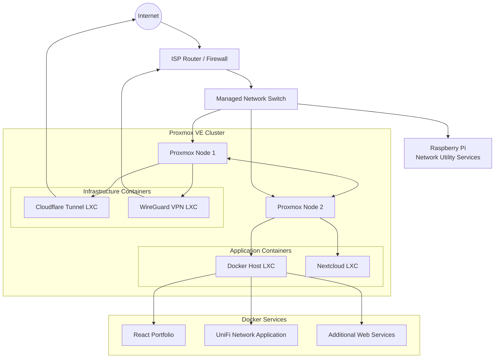

# Proxmox Homelab Infrastructure


## Overview

This repository presents the architecture, services, security practices and technical decisions behind my personal homelab.

The environment is built around a two-node Proxmox VE cluster hosting Linux containers, Docker workloads, private cloud services, secure remote-access services and network-management tools.

The goal of this project is to demonstrate practical experience with:

- Server virtualization
- Proxmox VE clustering
- Linux system administration
- LXC containers
- Docker and Docker Compose
- Network configuration and troubleshooting
- VPN deployment
- Reverse tunnels
- Self-hosted applications
- Infrastructure security
- Backup planning
- Technical documentation

> **Privacy notice:** this repository contains sanitized examples only. Real IP addresses, domains, credentials, tokens, private keys, email addresses, hardware serial numbers and infrastructure identifiers are excluded or replaced with documentation placeholders.

---

## Architecture



Detailed documentation:

- [Architecture](docs/architecture.md)
- [Infrastructure inventory](docs/infrastructure.md)
- [Network architecture](docs/networking.md)
- [Security model](docs/security.md)
- [Services](docs/services.md)
- [Backup strategy](docs/backup-strategy.md)
- [Monitoring and maintenance](docs/monitoring.md)
- [Challenges and lessons learned](docs/challenges.md)
- [Future improvements](docs/future-improvements.md)

---

## Infrastructure Summary

| Component | Role | Technology |
|---|---|---|
| Proxmox Node 1 | Virtualization and infrastructure workloads | Proxmox VE |
| Proxmox Node 2 | Virtualization and application workloads | Proxmox VE |
| Docker Host | Containerized applications | Debian, Docker, Docker Compose |
| Cloudflare Connector | Secure publication of selected web services | cloudflared |
| WireGuard Server | Encrypted remote access | WireGuard |
| Nextcloud Server | Private cloud platform | Apache, MariaDB, PHP, Redis |
| Raspberry Pi | Network utility services | Raspberry Pi OS |
| Managed Switch | Wired network connectivity | Managed Ethernet switch |
| ISP Router | Internet gateway, NAT and firewall | ISP-provided router |

All names and addresses shown in this repository are generic documentation examples.

---

## Hosted Services

### React Portfolio

My personal portfolio is deployed as a containerized React application.

Main technologies:

- React
- Node.js
- Nginx
- Docker
- Docker Compose
- Cloudflare Tunnel

The application is built in a Node.js container and served by Nginx using a lightweight production image.

### Nextcloud

Nextcloud provides private file synchronization and remote access to personal documents.

Main components:

- Debian Linux
- Apache
- MariaDB
- PHP
- Redis
- APCu
- Cloudflare Tunnel

The service runs in a dedicated LXC container to isolate the application, database and data storage from other workloads.

### UniFi Network Application

The UniFi Network Application provides centralized management and visibility for supported network equipment.

It is deployed as a Docker service on the dedicated Docker host.

### Cloudflare Tunnel

A dedicated Linux container runs the Cloudflare connector.

This allows selected web services to be published without directly exposing their internal HTTP ports through the router.

### WireGuard VPN

WireGuard provides encrypted remote access to the private management network.

The VPN runs in a dedicated LXC container and remains separated from public-facing web applications.

---

## Network Design

The homelab uses a private RFC1918 network.

Documentation examples use the following reserved documentation networks:

```text
Local documentation network: 192.0.2.0/24
VPN documentation network:   198.51.100.0/24
Public documentation address: 203.0.113.10
Example domain:               homelab.example.com
```

These values do **not** represent the real production environment.

Example logical addressing:

| System | Documentation address |
|---|---|
| Gateway | `192.0.2.1` |
| Proxmox Node 1 | `192.0.2.10` |
| Proxmox Node 2 | `192.0.2.11` |
| Docker Host | `192.0.2.20` |
| Cloudflare Connector | `192.0.2.21` |
| WireGuard Server | `192.0.2.22` |
| Nextcloud Server | `192.0.2.23` |
| Raspberry Pi | `192.0.2.30` |

See [networking.md](docs/networking.md) for more details.

---

## Security Approach

The environment follows several security principles:

- Separation of services into dedicated containers
- No credentials stored in Git
- No private keys committed to the repository
- VPN access for private administration
- Cloudflare Tunnel for selected public applications
- Minimal router port forwarding
- Regular Linux package updates
- Reduced attack surface
- Container isolation
- Sanitized infrastructure documentation
- Backup verification
- Environment variables for application secrets
- Example configurations instead of production configurations

More details: [security.md](docs/security.md).

---

## Service Isolation

```text
Public web access
        |
        v
Cloudflare connector
        |
        v
Selected internal applications

Remote administration
        |
        v
WireGuard VPN
        |
        v
Private management network

Containerized applications
        |
        v
Dedicated Docker LXC

Private cloud
        |
        v
Dedicated Nextcloud LXC
```

This design limits dependencies between services and makes troubleshooting, maintenance and recovery easier.

---

## Docker Deployment Model

Docker Compose is used to define multi-container services.

Production files containing credentials are not included. Only sanitized templates are stored in this repository:

```text
examples/
├── docker-compose.example.yml
└── environment.example
```

Example deployment workflow:

```bash
cp examples/environment.example .env
cp examples/docker-compose.example.yml docker-compose.yml

docker compose config
docker compose up -d
docker compose ps
```

---

## Backup Strategy

The backup strategy is designed around multiple recovery levels:

1. Proxmox container and virtual-machine backups
2. Application-level backups
3. Database exports
4. Configuration backups
5. External copies of critical data
6. Periodic restoration testing

More details: [backup-strategy.md](docs/backup-strategy.md).

---

## Monitoring and Maintenance

The environment is maintained through:

- Proxmox resource monitoring
- Docker container status checks
- Linux service status checks
- Application logs
- Storage-capacity monitoring
- Tunnel connector status monitoring
- VPN connectivity verification
- Operating-system updates
- Application updates
- Recovery testing

Generic commands:

```bash
systemctl --failed
systemctl status SERVICE_NAME

docker compose ps
docker compose logs --tail=100

df -h
free -h
uptime
```

---

## Troubleshooting Experience

Building this homelab included troubleshooting:

- Static address changes affecting internal services
- Cloudflare connector stability
- HTTP protocol configuration
- Docker application redeployment
- Browser and proxy caching
- Nextcloud reverse-proxy configuration
- WebDAV connectivity
- VPN routing and NAT
- Linux service startup
- Network forwarding
- Container startup ordering
- Raspberry Pi network sharing
- Remote application accessibility
- Service separation and resource planning

See [challenges.md](docs/challenges.md).

---

## Skills Demonstrated

### Virtualization

- Proxmox VE administration
- Two-node cluster management
- LXC deployment
- Resource allocation
- Container startup configuration
- Virtual networking
- Service migration

### Linux Administration

- Debian administration
- Package management
- systemd services
- Network troubleshooting
- Permissions
- Web-server configuration
- Log analysis
- Shell scripting

### Containers

- Docker
- Docker Compose
- Multi-stage images
- Nginx
- Container networking
- Persistent volumes
- Environment variables
- Service lifecycle management

### Networking

- TCP/IP
- Private addressing
- NAT
- Port forwarding
- DNS
- Reverse tunnels
- VPN routing
- Managed switching
- Remote access

### Security

- Service isolation
- Secrets management
- Reduced attack surface
- VPN-based administration
- Secure tunnelling
- Configuration sanitization
- Backup planning

---

## Repository Structure

```text
.
├── README.md
├── SECURITY.md
├── LICENSE
├── .gitignore
├── docs/
│   ├── architecture.md
│   ├── infrastructure.md
│   ├── networking.md
│   ├── security.md
│   ├── services.md
│   ├── backup-strategy.md
│   ├── monitoring.md
│   ├── challenges.md
│   └── future-improvements.md
├── diagrams/
│   ├── architecture-diagram.md
│   └── network-diagram.md
├── examples/
│   ├── docker-compose.example.yml
│   ├── cloudflared-config.example.yml
│   ├── wireguard-server.example.conf
│   ├── wireguard-client.example.conf
│   └── environment.example
├── screenshots/
│   └── README.md
└── scripts/
    ├── update-containers.example.sh
    ├── service-health-check.example.sh
    └── backup-example.sh
```

---

## Planned Improvements

Future improvements may include:

- Dedicated backup server
- Centralized monitoring
- Automated health checks
- Centralized log management
- Network segmentation
- Additional firewall rules
- Infrastructure-as-code templates
- Automated configuration validation
- UPS integration
- Disaster-recovery documentation
- High-availability testing

---

## Privacy Notice

The following information has intentionally been removed or replaced:

- Real IP addresses
- Public IP addresses
- MAC addresses
- Domain names
- Email addresses
- Usernames
- Passwords
- API keys
- Tunnel tokens
- VPN keys
- SSH keys
- Container identifiers
- Hardware serial numbers
- Router configuration
- Firewall source addresses
- Backup destinations
- Personal files
- Application data

---

## Author

**Yacine Zakat**

IT Support and Application Support Technician with experience in Microsoft 365, Windows and Linux environments, virtualization, Docker, networking and self-hosted services.

This homelab is used for continuous learning, experimentation and practical infrastructure administration.

---

## Disclaimer

This repository is provided for demonstration and educational purposes.

All configurations are sanitized examples and must be reviewed before use in another environment.
