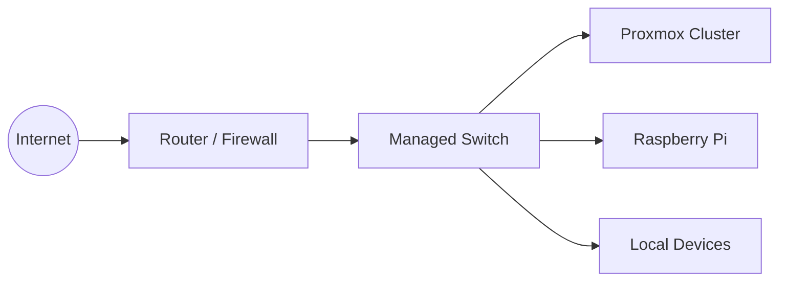

# Network Architecture

## Overview

The homelab uses a private local network behind an ISP router.

The public documentation uses addresses reserved for examples.

## Documentation Addressing

| Network | Example Range |
|---|---|
| Local network | `192.0.2.0/24` |
| VPN network | `198.51.100.0/24` |
| Public example network | `203.0.113.0/24` |

These values do not represent the real production environment.

## Logical Network



## Remote Access

### Cloudflare Tunnel

Used for selected HTTP and HTTPS applications.

```text
Internet client
      |
      v
Cloudflare network
      |
      v
Outbound tunnel connector
      |
      v
Authorized internal application
```

### WireGuard

Used for private administrative access.

```text
Remote administrator
      |
      v
Encrypted WireGuard tunnel
      |
      v
Private management network
```

## Security Boundaries

The following interfaces remain private:

- Proxmox web interface
- SSH management interfaces
- Docker administration
- UniFi administration
- Database ports
- Nextcloud database
- Internal dashboards
- Backup services

## DNS

Public DNS is used only for services intentionally published through a secure tunnel.

Internal services use private addresses that are not included in this repository.

## Router Configuration

Router screenshots, firewall exports, real external addresses and exact forwarding rules are excluded.

## Network Troubleshooting Checklist

1. Confirm link state
2. Confirm interface address
3. Confirm default route
4. Confirm DNS resolution
5. Confirm local application availability
6. Confirm firewall forwarding
7. Confirm NAT rules
8. Confirm remote service reachability
