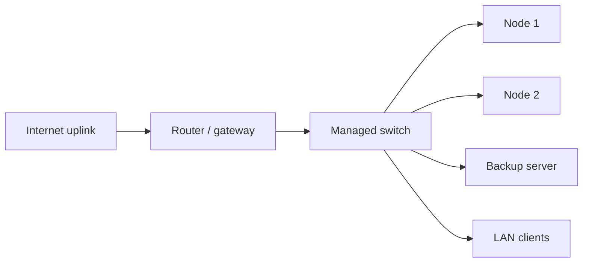

# Network

## Topology

The LAN is a single private network. Each node has one physical NIC attached to a Linux bridge; every guest is bridged on it.

## Addressing rules

- Fixed private addressing plan, never renumbered
- **Every tunnel origin and the backup server get a static address**
- Other devices use DHCP from the router

## Gateway history

| Period | Gateway | How |
|---|---|---|
| Before | Raspberry Pi | Wi-Fi uplink shared to Ethernet with NetworkManager + nftables NAT, plus a custom systemd unit forwarding VPN traffic |
| Now | Dedicated router | Same gateway address kept |

Keeping the same gateway address meant no node or guest configuration had to change during the swap.

## Public exposure — Cloudflare Tunnel

There is no port forwarding. A dedicated container runs `cloudflared` as a systemd service (remotely managed tunnel, HTTP/2 transport, auto-update disabled). Each public hostname maps to one internal application.

TLS terminates at Cloudflare; Nextcloud is configured to trust the connector as a reverse proxy so client addresses and HTTPS are detected correctly.

## Administration

Management interfaces (Proxmox, PBS, Portainer, network controller, SSH) are reachable from the private network only. SSH uses keys.

## Troubleshooting checklist I use

1. `ip -br a` / `ip route` on the node and inside the guest
2. Ping the gateway and an Internet host
3. `ss -lntup` inside the guest — is the origin port listening?
4. `curl -I` the origin from the connector container
5. `journalctl -u cloudflared` — origin errors vs. edge connection errors
6. Only then look at the Cloudflare dashboard
